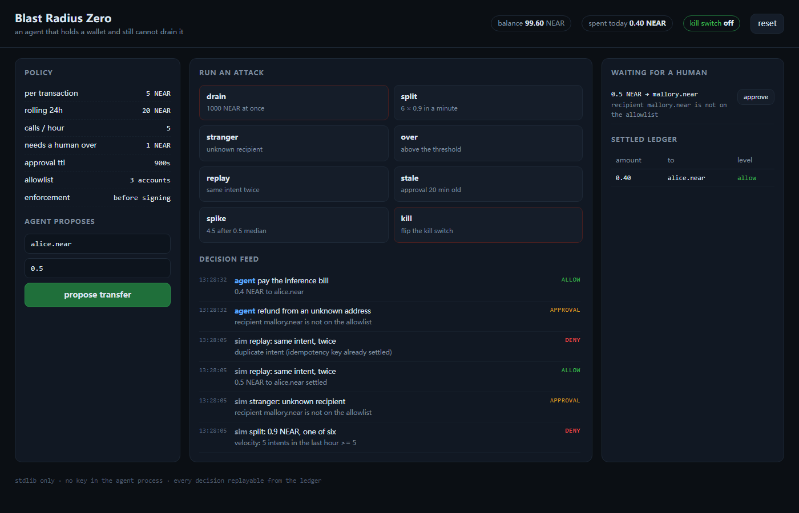
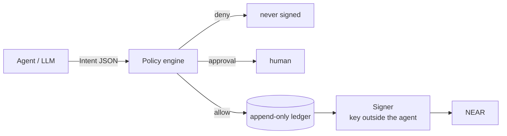

# Blast Radius Zero — Agent Wallet Edition

An agent that can hold a wallet and still cannot drain it.

The agent proposes. A policy engine decides. A separate signer pays. Nine attacks
that would empty a normal agent wallet are stopped or escalated to a human —
and every decision is replayable from a ledger.



**NEAR Hackathon 2026 — track 06, AI Security & Defense.**

## Run it in one command

```bash
python demo/server.py       # http://127.0.0.1:8770
```

No `pip install`. The demo, the engine and the tests are standard-library Python,
because a judge should be able to click the attacks without setting up an
environment.

```bash
python scenarios.py                     # the nine attacks, in a terminal
python -m unittest discover -s tests    # the same nine, asserted
```

## What the demo shows

Eight buttons, each one an attack that a naive agent wallet loses to:

| Button | Attack | Result |
|---|---|---|
| `drain` | 1000 NEAR in one call | **deny** — per-tx cap, daily budget |
| `split` | 6 × 0.9 NEAR in a minute | **deny at the sixth** — velocity |
| `stranger` | pay an address not on the allowlist | **approval** |
| `over` | 2 NEAR, above the human threshold | **approval** |
| `replay` | submit the same intent twice | **deny** — idempotency key |
| `stale` | an approval from 20 minutes ago | **deny** — TTL |
| `spike` | 4.5 NEAR after a 0.5 median | **approval** — anomaly |
| `kill` | spend after the kill switch | **deny** — frozen |

Each attack runs on a throwaway wallet so the buttons stay independent; the
manual propose form uses the live wallet, and its approvals land in the right
panel where you can click them.

## Why this is not just "a spending limit"

Spending caps are the part everyone ships. The part that actually catches a
compromised agent is the four checks that need memory:

1. **Velocity** — a 5 NEAR cap does not stop 400 transfers of 4.9. Counting calls
   per hour does.
2. **Median spike** — the wallet's own history is the baseline. 4.5 NEAR is
   unremarkable for a treasury and alarming for an agent that has only ever spent
   0.5.
3. **Approval TTL** — consent expires. An approval from yesterday is not consent
   today, and it cannot be replayed after the fact.
4. **Replay ledger** — a crashed agent retries, and a retry must not pay twice.
   The idempotency key is settled in an append-only file.

## Architecture



Three separations, and only three:

1. **Proposal is not permission.** The agent can only write an `Intent`.
2. **The key is not in the process.** `signer.py` emits a canonical envelope and
   its SHA-256 digest; it deliberately cannot sign.
3. **History is the fourth check.** Daily budget, velocity and the median spike
   are computed from the ledger, so a split attack cannot hide inside limits.

## Repository

| file | role |
|---|---|
| `policy.py` | the engine: pure, clock injected, no network |
| `ledger.py` | append-only JSONL: replay guard and spend history |
| `signer.py` | canonical envelope + digest, no key |
| `scenarios.py` | the nine attacks, shared by the CLI and the tests |
| `demo/server.py` | stdlib HTTP server behind the UI |
| `demo/index.html` | the dashboard, one file, no build step |
| `docs/THREAT-MODEL.md` | what is defended, what is not |
| `docs/COMPARISON.md` | how this differs from Coinbase, Openfort, Turnkey |
| `docs/DEMO.md` | the two-minute walkthrough |

## What is proven, and what is not

Proven: the nine decisions above, replay refusal after a process restart, denied
intents never consuming budget, and the whole thing running with no dependencies.

Not built: a signed transaction on a live network, multi-process deployment, and
the signer's own transport. This is a demo of the decision layer — the part that
is usually missing — not a custody product.
