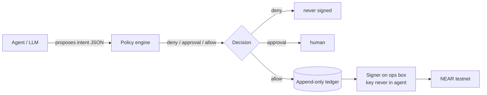

# Blast Radius Zero — Agent Wallet Edition

An agent that can hold NEAR, propose payments, and **cannot** drain the wallet.
Every intent passes a policy engine before anything is signed; the key lives
outside the agent process, so "the model agreed" is never the same as "the money
moved".

Built for **NEAR Hackathon 2026 — track 06, AI Security & Defense**
("Give AI money without giving it the keys to everything").

Repo: https://github.com/Hantsuo/near-agent-wallet

## The claim

> An agent with a wallet should be able to spend, and still be unable to hurt
> you. The difference is a policy engine that fails closed, plus a key it never
> sees.

Nine attack scenarios, all denied or escalated at the exact step where a human
should be involved:

```
PASS  sane transfer 0.5 NEAR                 allow
PASS  drain: 1000 NEAR in one go             deny     per_tx_max 5, daily 20
PASS  split: 6 x 0.9 NEAR in a minute        deny     5 allowed, 6th killed by velocity
PASS  new recipient mallory.near             approval not on allowlist
PASS  2 NEAR, above 1 NEAR threshold         approval human sign-off required
PASS  replay the same intent                 deny     idempotency key already settled
PASS  approval 20 minutes old                deny     ttl 900s
PASS  kill switch on                         deny     whole agent frozen
PASS  4.5 NEAR after a 0.5 median            approval 5x spike against own history
```

## Architecture



Three separations, and only three:

1. **Proposal is not permission.** The agent only ever writes an `Intent`. The
   engine decides, the ledger records, the signer signs.
2. **The key is not in the process.** This repo produces a canonical envelope
   and its SHA-256 digest; `near-cli` signs it elsewhere.
3. **History is the fourth check.** Daily budget, velocity and median-amount
   spike are computed from the ledger, so a split attack cannot hide inside
   per-transaction limits.

## Run it

Stdlib only, no dependencies:

```bash
python scenarios.py                    # the nine scenarios, printed
python -m unittest discover -s tests    # same nine, asserted
```

Policy lives in `policy.json`:

| key | meaning |
|---|---|
| `per_tx_max` | hard ceiling for one intent |
| `daily_max` | rolling 24 h budget |
| `hourly_count_max` | velocity cap, counts intents not value |
| `require_approval_over` | amount above which a human must sign |
| `allowlist` | recipients that do not need review |
| `approval_ttl_s` | how long a human approval stays valid |
| `spike_multiple` | multiple of median that triggers review |
| `kill_switch` | deny everything, immediately |

## Files

| file | role |
|---|---|
| `policy.py` | the engine; pure, clock injected, no network |
| `ledger.py` | append-only JSONL; replay guard and spend history |
| `signer.py` | canonical envelope + digest; deliberately cannot sign |
| `scenarios.py` | the nine attacks, shared by demo and tests |
| `tests/test_policy.py` | assertions, including replay across a restart |

## What is proven, and what is not

Proven by the test run above: the nine decisions, replay refusal after a process
restart, and that denied intents never consume budget.

Not built yet: broadcasting a signed transaction to testnet (needs a funded
testnet key on the ops box), and the web UI. The Vultr Agent Rush version of
this project carries the container sandbox for code execution; this edition is
the wallet half of the same threat model.
